*Building strong fundamentals and real projects, one commit at a time.*

---

## 01 — About Me

I'm an Electronics and Communication Engineering student who is going all-in on software development. I enjoy solving problems, learning how computers really work, and building things that people can use.

- 🎓 **Education:** B.E. in Electronics & Communication Engineering, DSATM, Bengaluru
- 💻 **Focus:** Data Structures & Algorithms, CS fundamentals
- 🎯 **Goal:** Software Development Engineer (SDE) role
- 🌍 **Open to:** Opportunities in India and abroad
- 📍 **Location:** Bengaluru, India

> My approach: learn the fundamentals deeply, then build things that use them.

---

## 02 — Tech Stack

**Languages**

**Tools**

---

## 03 — Selected Projects

<table>
<tr>
<td width="50%">

**📦 AI Smart Tutor**

An AI-powered tutor that helps students learn and get answers to their questions.

`Python` `AI`

[Explore Repository →](https://github.com/nizamuddin-a/AI_Smart_Tutor)

</td>
</tr>
</table>

---

## 04 — Currently Learning

| Focus Area | Topics |
|---|---|
| DSA | Arrays, Linked Lists, Stacks, Queues, Trees, Graphs |
| CS Fundamentals | Operating Systems, DBMS, Computer Networks |
| Problem Solving | LeetCode / GeeksforGeeks practice |

---

## 05 — Let's Connect

I'm looking for internships and opportunities where I can grow as a software engineer and contribute to real projects.

*Learn deeply. Build consistently. Ship things.*

